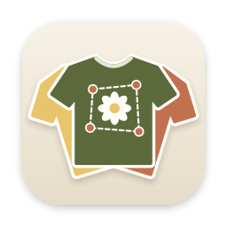
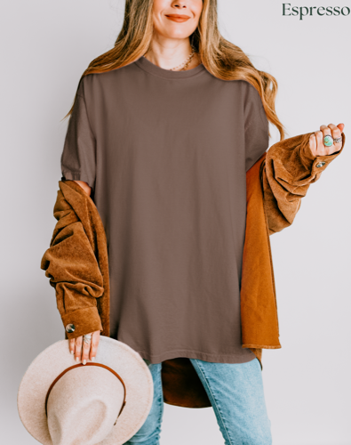
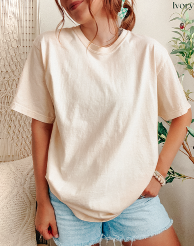
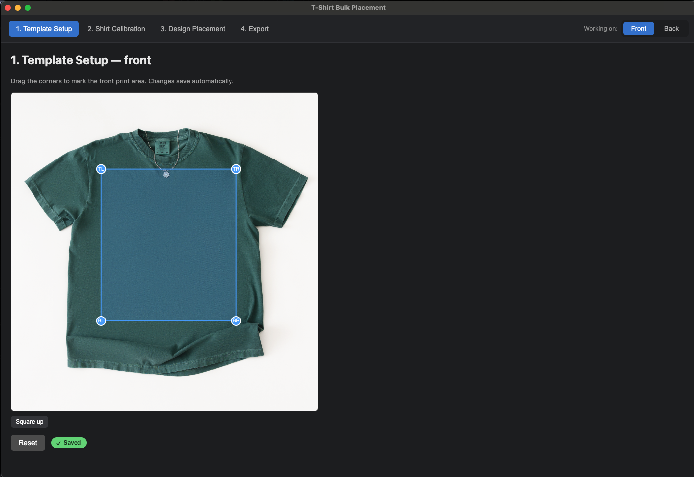
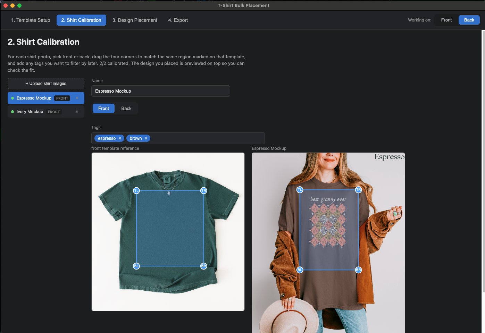
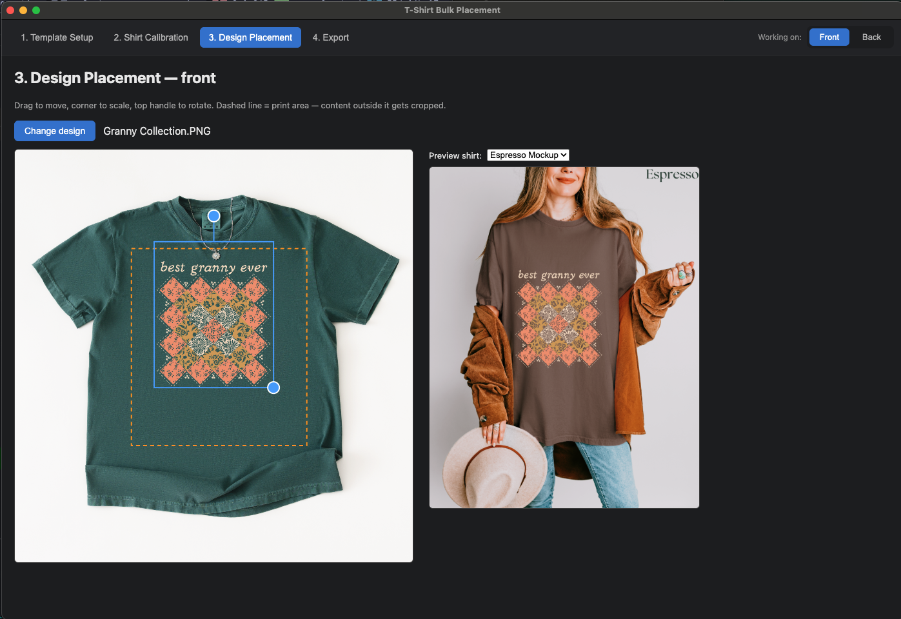
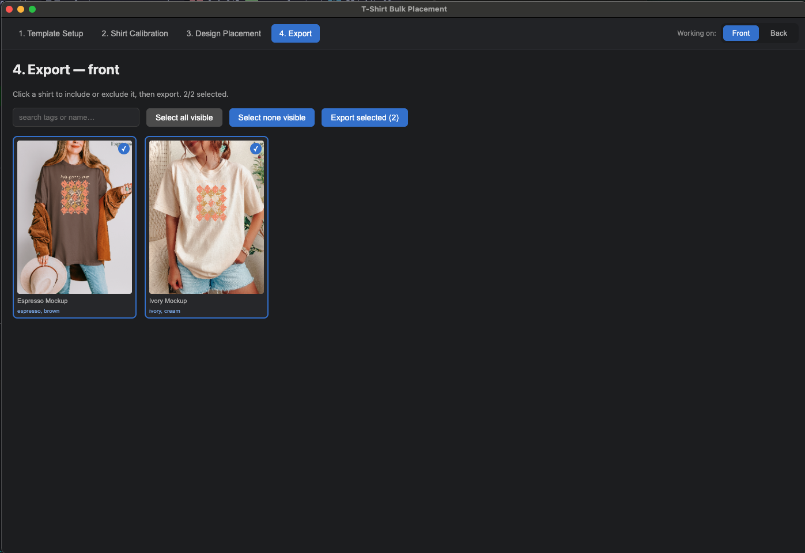

<a id="readme-top"></a>

<br />
<div align="center">
  

  <h3 align="center">T-Shirt Bulk Placement</h3>

  <p align="center">
    Position a design once, drop it onto every shirt mockup photo automatically — with real perspective warping, not a flat paste.
    <br />
    <a href="#usage"><strong>Jump to the walkthrough »</strong></a>
  </p>
</div>

<!-- TABLE OF CONTENTS -->
<details>
  <summary>Table of Contents</summary>
  <ol>
    <li>
      <a href="#about-the-project">About The Project</a>
      <ul>
        <li><a href="#built-with">Built With</a></li>
      </ul>
    </li>
    <li>
      <a href="#getting-started">Getting Started</a>
      <ul>
        <li><a href="#prerequisites">Prerequisites</a></li>
        <li><a href="#installation">Installation</a></li>
        <li><a href="#building-a-macos-app">Building a macOS App</a></li>
      </ul>
    </li>
    <li>
      <a href="#usage">Usage</a>
      <ul>
        <li><a href="#workroom-template">Workroom: Template</a></li>
        <li><a href="#workroom-mockups">Workroom: Mockups</a></li>
        <li><a href="#studio-arrange">Studio: Arrange</a></li>
        <li><a href="#studio-gather--export">Studio: Gather &amp; export</a></li>
      </ul>
    </li>
    <li><a href="#where-your-data-lives">Where Your Data Lives</a></li>
    <li><a href="#roadmap">Roadmap</a></li>
    <li><a href="#acknowledgments">Acknowledgments</a></li>
  </ol>
</details>

<!-- ABOUT THE PROJECT -->
## About The Project

Say you shoot (or buy) a stack of lifestyle mockup photos for a blank shirt — different colors, different models, different crops and angles:

<p align="center">
  
  
</p>

Normally, placing one design across every one of those photos means eyeballing position, scale, and rotation by hand, per photo, per design — and doing it again for the back of the shirt. This app removes that repetition:

1. Mark the print area once on a flat reference template (front and back separately).
2. Calibrate each mockup photo against that same reference area, once, ever.
3. From then on, position a design on the template a single time — it drops onto **every** calibrated mockup automatically, correctly warped to each photo's own scale and angle.

The result: what took one design × one photo × manual placement now takes one placement × every photo, automatically.

<p align="right">(<a href="#readme-top">back to top</a>)</p>

### Built With

* [![Electron][Electron.js]][Electron-url]
* [![React][React.js]][React-url]
* [![Vite][Vite.js]][Vite-url]
* Node.js `canvas` (node-canvas) for headless, full-resolution export
* A small self-contained homography/perspective-warp engine — no image-processing dependency

<p align="right">(<a href="#readme-top">back to top</a>)</p>

<!-- GETTING STARTED -->
## Getting Started

### Prerequisites

* Node.js 18+ and npm
  ```sh
  node -v
  npm -v
  ```

### Installation

1. Clone or copy this project locally
2. Install dependencies
   ```sh
   npm install
   ```
3. Launch the app
   ```sh
   npm run dev
   ```

### Building a macOS App

One command builds and packages a standalone `.app` (plus a `.dmg` and `.zip`) into `release/`:

```sh
npm run dist:mac
```

This handles rebuilding the native `canvas` module against Electron's own Node/V8 version automatically — no manual steps. The build is unsigned (no Apple Developer certificate configured), so macOS will show an "unidentified developer" warning on first launch; right-click the app and choose **Open** to bypass it once.

<p align="right">(<a href="#readme-top">back to top</a>)</p>

<!-- USAGE EXAMPLES -->
## Usage

The sidebar splits the app into two rooms:

- **Workroom** — one-time setup. Mark the template's print area and calibrate your mockup photos. Badges show how much is done.
- **Studio** — the everyday loop. Arrange a new design, then gather and export it onto every mockup.

The app opens in the Studio. If the side you're working on isn't set up yet, it shows a short checklist that links to the right Workroom screen. Each screen has its own **Front / Back** toggle in the top-right.

### Workroom: Template

Drag the four corner handles onto your flat reference template to mark the print area — the region every mockup photo's chest print will be calibrated against. Front and back each get their own reference area. Changes save automatically as you drag; **Undo changes** reverts back to how it looked when you opened that side.



### Workroom: Mockups

Add mockup photos with the button or by dropping them onto the list. To remove one, hover it, click **×**, then confirm. For each one: pick whether it's a front or back shot, drag its four corners to match the same region you marked on the template, and add any tags you want to filter by later (color, style, whatever's useful). If you've already arranged a design in the Studio, it's previewed live on top so you can check the fit while you calibrate.



### Studio: Arrange

Drop a design onto the page (or browse for one) and position it directly on the template — drag to move, the corner handle to scale, the top handle to rotate. The stitched outline is the print area from the Template screen: anything outside it gets cropped when it lands on a real shirt, so keep your design inside it. Click any calibrated mockup in the filmstrip to preview the actual warped result, then hit **Gather & export**.



### Studio: Gather & export

Every calibrated mockup for the current side shows up as a live-rendered thumbnail with your design already warped on. Search by tag or name to narrow the list, click thumbnails to pin or unpin them (search only affects what's *visible* — your selections elsewhere are untouched), then export. Finished images land in your **Downloads** folder, organized into a subfolder named after the design. **Open folder** jumps straight to it.



<p align="right">(<a href="#readme-top">back to top</a>)</p>

<!-- DATA STORAGE -->
## Where Your Data Lives

Everything you set up — templates, mockup photos, calibration, tags — is stored outside the app itself, in Electron's standard per-app data directory (`~/Library/Application Support/tshirt-automation` on macOS). That means updating or reinstalling the app never wipes your work. Exported images always go to your **Downloads** folder.

<p align="right">(<a href="#readme-top">back to top</a>)</p>

<!-- ROADMAP -->
## Roadmap

- [ ] Batch export multiple designs in one run
- [ ] Per-shirt manual nudge after auto-placement
- [ ] Editable print-area presets shareable across projects

<p align="right">(<a href="#readme-top">back to top</a>)</p>

<!-- ACKNOWLEDGMENTS -->
## Acknowledgments

* [Best-README-Template](https://github.com/othneildrew/Best-README-Template) — this document's structure

<p align="right">(<a href="#readme-top">back to top</a>)</p>

<!-- MARKDOWN LINKS -->
[Electron.js]: https://img.shields.io/badge/Electron-191970?style=for-the-badge&logo=Electron&logoColor=white
[Electron-url]: https://www.electronjs.org/
[React.js]: https://img.shields.io/badge/React-20232A?style=for-the-badge&logo=react&logoColor=61DAFB
[React-url]: https://reactjs.org/
[Vite.js]: https://img.shields.io/badge/Vite-646CFF?style=for-the-badge&logo=vite&logoColor=white
[Vite-url]: https://vitejs.dev/
